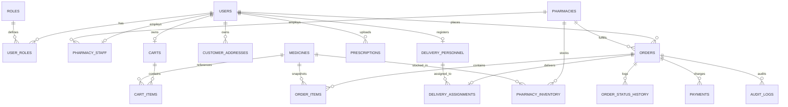
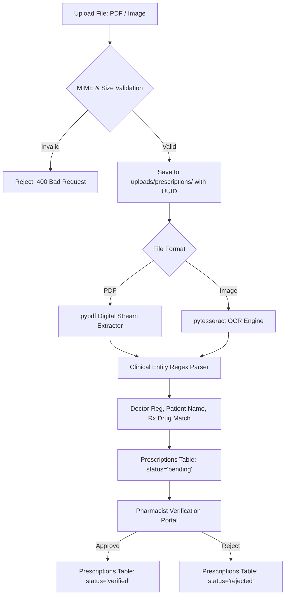

# MediApp Technical & System Architecture

Comprehensive engineering specification of the MediApp platform, detailing database schemas, order lifecycles, concurrency controls, clinical rules, and security enforcement.

---

## 1. Domain Model & Database Schema

MediApp utilizes an authoritative SQLite relational schema (configured with `PRAGMA foreign_keys = ON;` and `PRAGMA journal_mode = WAL;`).



### Table Inventory (17 Relational Tables):
1. `users`: Core identity table (email, password_hash, full_name, phone, google_id, is_active).
2. `roles`: Role definitions (`CUSTOMER`, `PHARMACY`, `DELIVERY`, `ADMIN`).
3. `user_roles`: Multi-role mapping with composite primary key.
4. `customer_addresses`: Delivery destination addresses with recipient phone and landmark.
5. `pharmacies`: Registered medical stores with license numbers, geolocation, and approval status.
6. `pharmacy_staff`: Association between pharmacy employees and their designated store.
7. `delivery_personnel`: Courier profiles with vehicle details and driving license registration.
8. `medicines`: Global catalogue (name, generic_name, strength, dosage_form, category, manufacturer, mrp, rx_required, pack_size, uses, side_effects).
9. `pharmacy_inventory`: Per-store inventory tracking (quantity, unit_price, batch_number, expiry_date, is_available, low_stock_threshold).
10. `prescriptions`: Uploaded medical documents with OCR extracted text, doctor/patient metadata, and verification status.
11. `carts`: Persistent shopping cart for customers linked to a designated fulfillment pharmacy.
12. `cart_items`: Itemized quantities with composite uniqueness (`cart_id`, `medicine_id`).
13. `orders`: Authoritative order entity (`ORD-YYYYMMDD-XXXX`, customer, pharmacy, address snapshot, financial totals, status, payment status).
14. `order_items`: Price and name snapshots of items at order placement time.
15. `order_status_history`: Immutable timeline of order transitions with responsible user and notes.
16. `payments`: Gateway transaction tracking (provider, order ID, payment ID, signature, status, error code).
17. `delivery_assignments`: Real-time courier dispatch tracking (rider, pickup timestamp, delivery milestone timestamps, OTP).

---

## 2. One Shared Order Engine & Finite State Machine

All four portals operate on the **exact same order record** in SQLite. Order IDs follow the format `ORD-YYYYMMDD-XXXX` (e.g. `ORD-20261025-0001`) and are treated as immutable string keys across all APIs, database foreign keys, and UI presentations.

### Order State Transitions:

```
[Customer Checkout]
       │
       ▼
    PLACED ────────── (Customer/Admin Cancel) ─────────► CANCELLED
       │                                                     ▲
       ▼                                                     │
   CONFIRMED ──────── (Pharmacy Reject/Stockout) ────────────┤
       │                                                     │
       ▼                                                     │
   PACKAGING ──────── (Pharmacy Exception) ──────────────────┘
       │
       ▼
 READY_FOR_PICKUP
       │
       ▼ (Rider Claims / Dispatches)
    ASSIGNED
       │
       ▼ (Rider Picked Up at Pharmacy)
OUT_FOR_DELIVERY
       │
       ▼ (Doorstep Handover)
   DELIVERED
```

### State Transition Validation Matrix:
| Current Status | Target Status | Permitted Roles | Preconditions & Effects |
|---|---|---|---|
| `PLACED` | `CONFIRMED` | `PHARMACY`, `ADMIN` | Prescriptions verified if Rx items present. |
| `PLACED` | `CANCELLED` | `CUSTOMER`, `ADMIN` | Restores reserved inventory back to `pharmacy_inventory`. |
| `CONFIRMED` | `PACKAGING` | `PHARMACY` | Pharmacy begins dispensing and batch packing. |
| `PACKAGING` | `READY_FOR_PICKUP` | `PHARMACY` | Package prepared; enters delivery pool. |
| `READY_FOR_PICKUP` | `ASSIGNED` | `DELIVERY`, `ADMIN` | Rider claims order; locks assignment. |
| `ASSIGNED` | `OUT_FOR_DELIVERY` | `DELIVERY` | Rider confirms pickup at pharmacy location. |
| `OUT_FOR_DELIVERY` | `DELIVERED` | `DELIVERY` | Doorstep delivery complete; sets `delivered_at`. |
| `CONFIRMED` / `PACKAGING` | `CANCELLED` | `PHARMACY`, `ADMIN` | Restores reserved inventory; initiates refund if paid. |

---

## 3. Decimal-Safe Monetary Arithmetic (`PricingService`)

To eliminate IEEE 754 binary floating-point representation anomalies in financial calculations, all monetary operations are performed strictly using Python's `decimal.Decimal` module with `ROUND_HALF_UP` quantizing:

```python
TWOPLACES = Decimal('0.01')

def calculate_order_totals(items, delivery_distance_km=3.5, discount_code=None):
    subtotal = sum(Decimal(str(it['unit_price'])) * Decimal(str(it['quantity'])) for it in items)
    tax = (subtotal * Decimal('0.05')).quantize(TWOPLACES, rounding=ROUND_HALF_UP) # 5% GST
    delivery_fee = Decimal('0.00') if subtotal >= Decimal('500.00') else Decimal('40.00')
    total = (subtotal + tax + delivery_fee - discount).quantize(TWOPLACES, rounding=ROUND_HALF_UP)
```

The computed `subtotal`, `tax_amount`, `delivery_fee`, and `total_amount` are saved as snapshots on the `orders` table. Any subsequent catalogue price adjustments never affect historical order receipts.

---

## 4. Atomic Inventory Concurrency & Overselling Prevention

All stock operations are executed within database transactions using atomic SQL decrements:

```sql
UPDATE pharmacy_inventory
SET stock_quantity = stock_quantity - ?
WHERE pharmacy_id = ? AND medicine_id = ? AND stock_quantity >= ?;
```

If the row count modified is `0`, a `ValueError("Insufficient stock")` is raised, rolling back the transaction. When an order is cancelled, stock is atomically incremented:

```sql
UPDATE pharmacy_inventory
SET stock_quantity = stock_quantity + ?
WHERE pharmacy_id = ? AND medicine_id = ?;
```

---

## 5. Clinical Drug-Drug Interaction (DDI) & Generic Substitution

1. **Substance Normalization**:
   - Active ingredients are extracted and standardized (e.g. `"Aspirin (Acetylsalicylic Acid)"` → `"aspirin"`).
   - Dosage forms and salt modifiers are stripped to enable universal molecular matching.
2. **Pairwise Screening**:
   - Ingested cart items are paired combinations $C(N, 2)$ and matched against clinical contraindication rules in `app/data/ddi_rules.json`.
   - Interactions are categorized into `major` (contraindicated) or `moderate` (caution required) with clinical mechanism descriptions.
3. **Generic Bioequivalent Discovery**:
   - For any branded medicine, the engine queries the catalogue for identical `generic_name`, `strength`, and `dosage_form`.
   - Compares MRPs and computes percentage customer savings (e.g., swapping branded *Lipitor 20mg* for generic *Atorvastatin 20mg* yields up to 79% cost savings).

---

## 6. Multi-Tier Prescription OCR & Verification Pipeline



Prescription-required medicines cannot be ordered without attaching a verified prescription ID, enforced server-side in `OrderService.create_order_from_cart`.

---

## 7. Dual Payment Architecture (Razorpay Real & Demo Modes)

The `PaymentProvider` abstract interface decouples payment gateways from order logic:

- `DemoPaymentProvider`:
  - Simulates payment order creation and immediate completion or intentional failure testing.
  - Automatically verifies signature using local mock tokens and updates payment status to `PAID`.
- `RazorpayPaymentProvider`:
  - Uses the official `razorpay` client to create remote orders: `client.order.create(...)`.
  - Verifies authentic webhooks and browser callbacks using cryptographic HMAC-SHA256:
    ```python
    client.utility.verify_payment_signature({
        'razorpay_order_id': order_id,
        'razorpay_payment_id': payment_id,
        'razorpay_signature': signature
    })
    ```
  - Protects against replay attacks by persisting transaction signatures with uniqueness checks.

---

## 8. Cross-Portal Real-time Synchronization (`Sync.js`)

To keep Customer, Pharmacy, Delivery, and Admin views synchronized without unbounded WebSocket connections or memory leaks:
- Implemented **Visibility-Aware Adaptive Polling** in `app/static/js/sync.js`.
- Automatically reduces polling frequency or pauses when the browser tab is hidden (`document.visibilityState === 'hidden'`).
- Cleans up active polling intervals when unmounting or switching portal views, completely preventing memory leaks and infinite request loops.
- Provides manual refresh buttons across all portal tables and order queues.

---

## 9. Security & Role-Based Access Control (RBAC)

1. **Session & Cookie Security**:
   - Secure HTTP-only cookies with `SameSite=Lax`.
   - CSRF protection enabled for browser sessions.
2. **Authorization Boundary Enforcement**:
   - Every protected route is guarded by `@login_required` and `@roles_required('ROLE')`.
   - Role escalation prevention: Users cannot assign themselves new roles.
3. **Indirect Object Reference (IDOR) Protection**:
   - Orders can only be queried by the purchasing customer, assigned pharmacy, assigned rider, or admin.
   - Prescriptions are strictly isolated to the uploading customer and licensed pharmacy staff.
